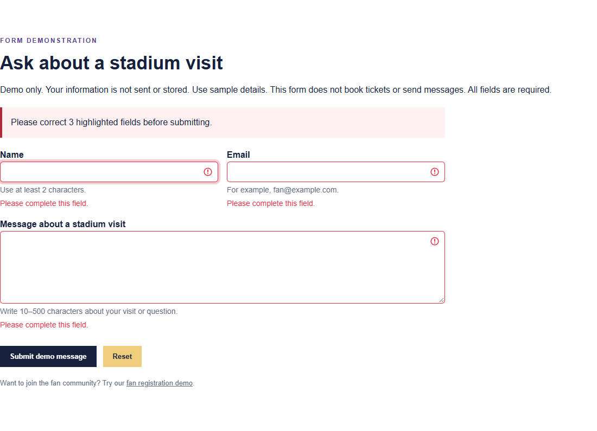
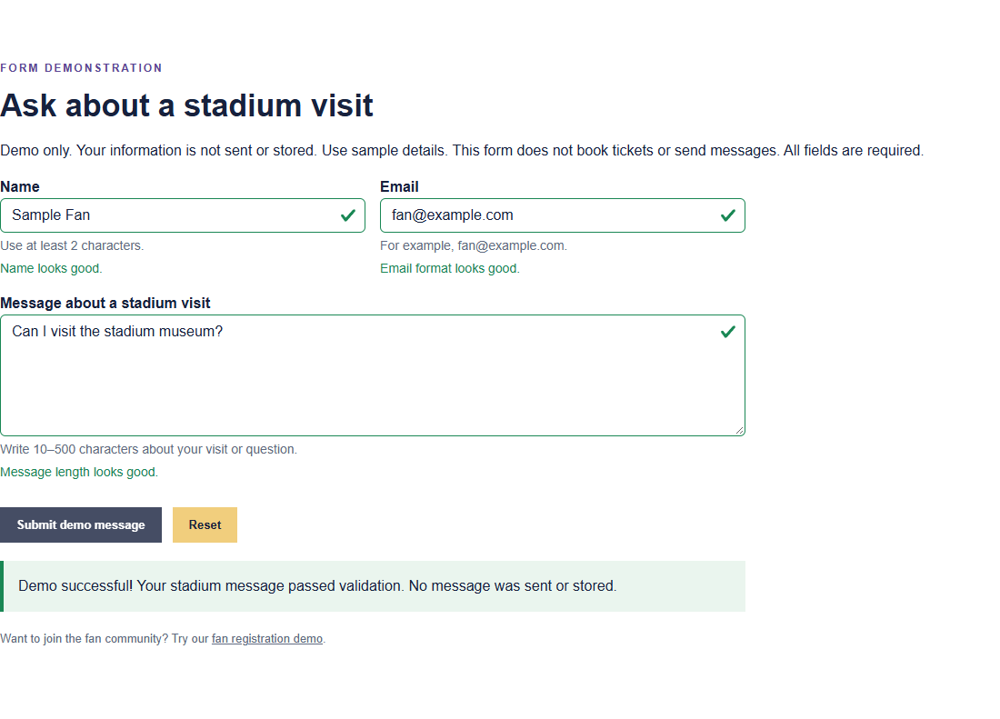
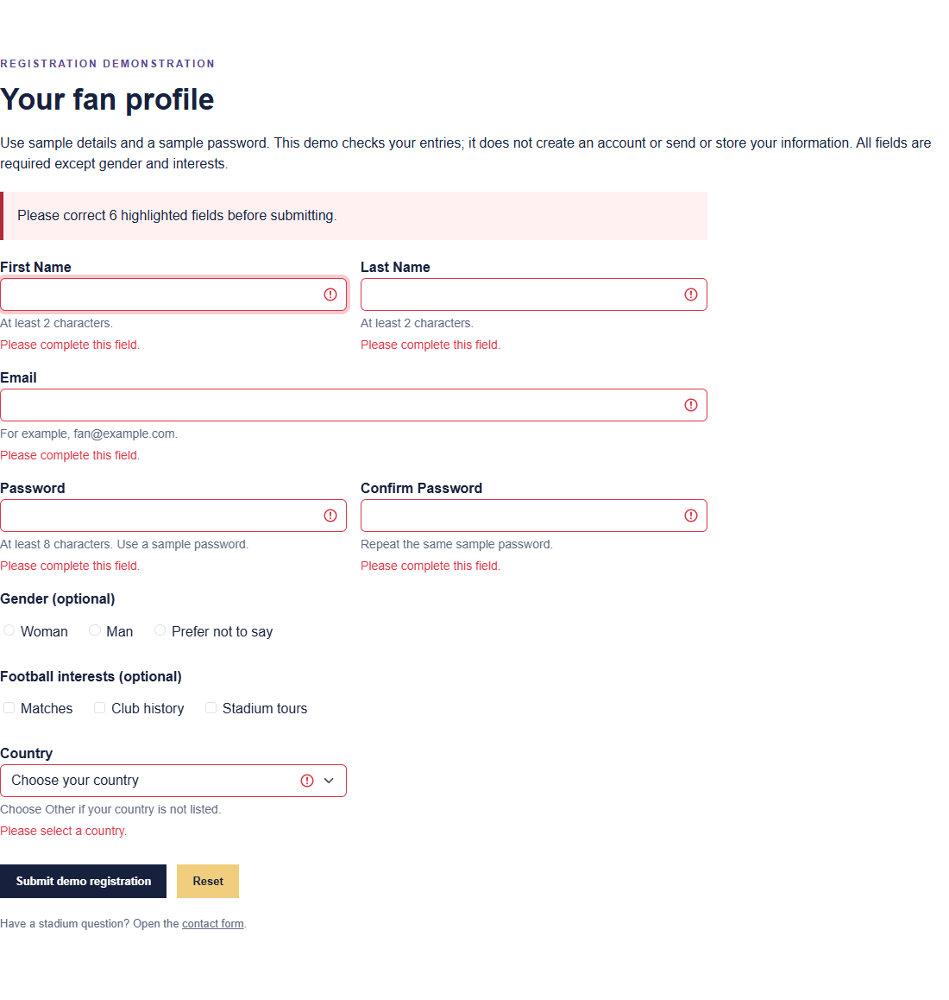
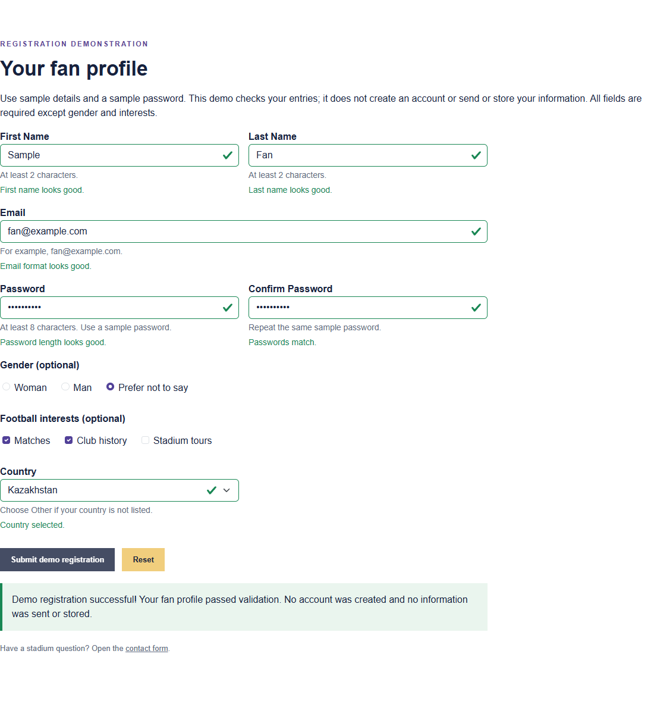
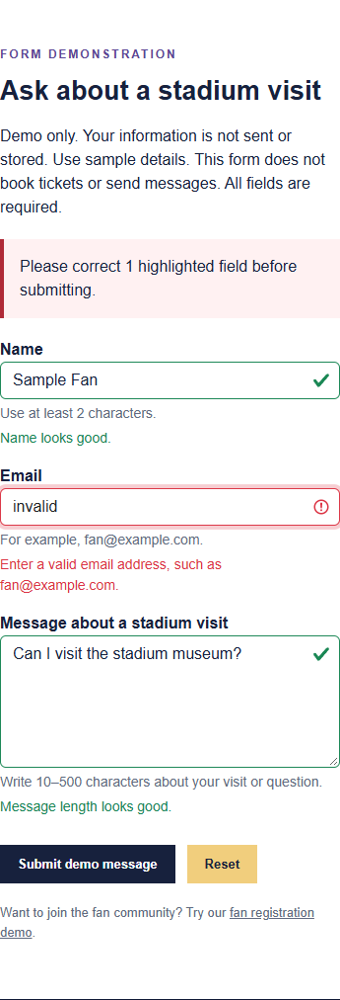
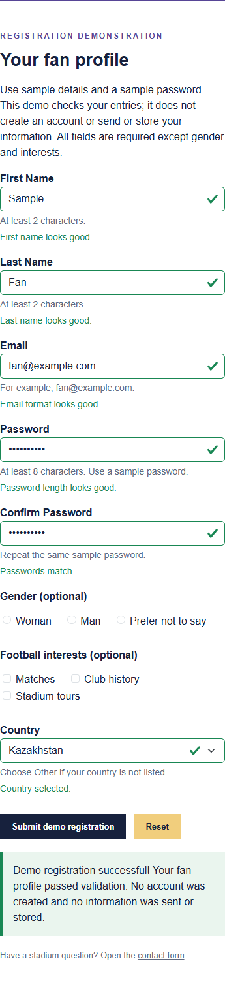

# Real Madrid Fan Website

## Project topic

A student fan website about Real Madrid football club.

## Project goal

Introduce visitors to the club, its players, history and
Santiago Bernabéu stadium.

## Target audience

Football fans and people who want to learn basic information
about Real Madrid.

## Team members and page responsibilities

| Team member | Page | Responsibility |
|---|---|---|
| Amantay Aiymzhan | index.html | Home page and links to other sections |
| Aruzhan Meirkhan | team.html | Player cards, squad and coach |
| Ayazhan Serikkazy | history.html | Club history and timeline |
| Nurailym Rakhatova | stadium.html | Stadium, gallery, FAQ and demo form |

The table above records the existing page responsibilities.
For Assignment 5, each member must make their own identifiable commits and
be able to explain their contribution. Do not attribute another person's
changes to a team member who did not make them.

demo-result.html is an additional form result page.
It does not replace any of the four main pages.

## Technologies

- HTML5
- CSS3
- Flexbox
- CSS Grid
- Media queries
- HTML5 constraints and the JavaScript Constraint Validation API
- Bootstrap 5.3.8 grid and form styles (stored locally)
- JavaScript for form feedback, password matching and demo submission
- Details and summary for the FAQ

Bootstrap is compiled only for the form components and grid, with selectors
scoped to `.fan-forms`. The original shared styles, photographs, colours,
headings and page layouts are retained. No Bootstrap JavaScript is needed.

## Files

- index.html — introduction to the club
- team.html — players and coach
- history.html — club history
- stadium.html — stadium information, gallery, FAQ and contact form
- register.html — fan registration form (Fan Club in the navigation)
- demo-result.html — retained explanation page; results now appear in the forms
- css/style.css — shared styles and mobile layout
- css/responsive.css — tablet and desktop media queries
- css/forms.css — form styling that matches the existing site
- css/bootstrap-forms.scss — source for the scoped Bootstrap components
- css/vendor/ — compiled Bootstrap CSS and its MIT licence
- js/forms.js — shared validation and demo submission
- tests/forms.test.cjs — repeatable browser tests
- docs/screenshots/ — actual browser screenshots for the teamwork evidence
- images/ — project images

## Responsive design

The website uses a mobile-first approach.

The base layout has one column.
Larger layouts are added with min-width media queries.

| Breakpoint | Changes | Reason |
|---|---|---|
| 768px | Two-column grids, horizontal home team section and timeline rows | Enough space for two readable content columns |
| 1024px | Three-column card grids, horizontal header and visit box | Enough space for three cards and a wider navigation layout |

The container uses a percentage width and a maximum width.
Images fit their containers, and navigation links can wrap.

## Flexbox and Grid

Flexbox is used for navigation, the home team section,
club facts, the timeline, the visit box and the footer.

Grid is used for topic cards, player cards, squad groups,
stadium photos and paired content sections.

The player grid and stadium gallery each contain six items.

## Assignment 5 Part 1 — teamwork forms

This repository contains the shared website for Tasks 0–4.
Individual JavaScript exercises (Tasks 6–12) belong in each student's
separate individual project. No assignment report is included here.

### Contact form — Tasks 0, 1 and 2

Open [Stadium → contact form](stadium.html#visit-form).
Name, Email and Message have meaningful `name` attributes, unique IDs
and visible labels connected with `for` and `id`.

| Control | HTML rule | What it enforces |
|---|---|---|
| Name | `required minlength="2"` | A name with at least 2 characters |
| Email | `required type="email"` | A nonempty email in the browser's accepted email format |
| Message | `required minlength="10" maxlength="500"` | A message of 10–500 characters |

Bootstrap `row`, `g-3`, `col-12`, `col-md-6`, `form-label` and `form-control`
classes provide the layout and controls. Helper text explains the rules.
The two short fields share a row from 768px and stack on smaller screens.

### Fan registration — Task 3

Open [Fan Club](register.html). First Name and Last Name are required
with `minlength="2"`; Email is required with `type="email"`.
Both password fields are required with `minlength="8"`.
JavaScript compares their values and calls `setCustomValidity()` when
they differ. Editing either password recalculates the comparison after
the first submission attempt, so the mismatch error clears when corrected.

Gender is an optional radio group containing “Prefer not to say”.
Football interests are optional checkboxes. Both groups use `fieldset`
and `legend`; every option has a label. Country is a required
`form-select` with an empty default option. Submit and Reset are provided.

### How validation works

1. `js/forms.js` attaches a submit listener, enables the demo submit button,
   and sets `noValidate` so the script can show Bootstrap feedback instead
   of browser popups. The HTML constraints still participate in validation.
2. The listener prevents navigation, checks the constraints and password
   match, then calls `checkValidity()`. Explicit length checks also cover
   programmatically assigned values; whitespace-only names/messages fail.
3. `.is-valid` and `.is-invalid` reflect each required field's current
   validity. `valid-feedback` and `invalid-feedback` show text as well as
   colour. Errors are linked with `aria-describedby`; `aria-invalid`, an
   alert summary and focus on the first invalid field assist navigation.
4. Invalid data never produces success. Valid data displays a local
   demonstration success message. Further edits clear stale success.
5. Reset restores empty values and optional choices, removes validation
   classes and messages, and clears custom password errors.

Use sample values. Neither form sends network requests, stores values,
creates real accounts nor books tickets. JavaScript is required for the
demo submission; without it, submit stays disabled and an explanation is
shown. There is no backend, database or external form service.

### Test record — Task 4

Tested in Microsoft Edge (Chromium) on 18 October 2026.
The automated suite passed 19 checks, including the cases below.
“Valid contact” means Name `Sample Fan`, Email `fan@example.com`,
Message `Can I visit the stadium museum?`.
“Valid registration” means First Name `Sample`, Last Name `Fan`,
Email `fan@example.com`, both passwords `Madrid123!`, Country `Kazakhstan`.
These are sample data, not real account credentials.

| Test input / action | Expected result | Actual result |
|---|---|---|
| Submit empty contact form | Block submission; show 3 errors | Pass — 3 errors; Name receives focus; no success |
| Contact: Name `A`, Email `not-an-email`, Message `Too short` (9 chars) | Reject all three | Pass — length and email feedback visible |
| Contact: otherwise valid, message of 10 or 500 `a` characters | Accept both boundary lengths | Pass — demo success in both cases |
| Type a 501st message character | `maxlength` prevents extra input | Pass — value remains 500 characters |
| Assign 501 message characters through a script, then submit | Reject bypass of HTML input limit | Pass — length error; no success |
| Contact: spaces only in Name and Message | Reject blank content | Pass — both fields invalid |
| Valid contact | Show success without sending or storing values | Pass — success; URL, request count and browser storage unchanged |
| Reset contact after success | Clear values and all feedback | Pass — empty, neutral form |
| Submit empty registration | Reject 6 required fields | Pass — all 6 show errors; optional groups stay optional |
| Registration: names `A` / `B`, email `invalid`, passwords `1234567`, country Kazakhstan | Reject short names, bad email and passwords under 8 chars | Pass — 5 invalid fields |
| Valid registration except confirmation `Different123!` | Block mismatched passwords | Pass — “Passwords must match” shown |
| Correct confirmation; then change the original password | Clear error, then detect the new mismatch | Pass — feedback updates in both directions |
| Valid registration except empty Country | Block submission | Pass — country error; no success |
| Valid registration, gender and interests unselected | Accept optional groups being empty | Pass — success with no data request or storage |
| Select Prefer not to say, Matches and Club history | Accept optional choices | Pass — choices selectable; success after submit |
| Reset registration after mismatch errors | Clear data, selections, errors and custom validity | Pass — neutral form; a subsequent valid submission succeeds |
| All pages at 320, 375, 768 and 1440px | No horizontal overflow; forms stack on mobile | Pass — all pages fit; paired fields stack below 768px |
| Mobile contact with bad email; valid mobile registration | Readable errors and working submission | Pass — feedback and success remain usable at 375px |

Labels, unique IDs, description references, disabled submission without
JavaScript, and absence of JavaScript runtime errors were also checked.

### Screenshots

Contact, invalid and valid states at 1440px:




Registration, invalid and valid states at 1440px:




Mobile form layouts at 375px:




## How to open the website

Keep the HTML files in the main project folder.
Keep css/ and images/ in the same folder.

Open index.html in a browser or use Live Server in VS Code.
The committed Bootstrap CSS works offline; installation is not needed to
view the website. Open Stadium for the contact form or Fan Club for registration.

## Development checks

With Node.js and pnpm installed:

```sh
pnpm install
pnpm exec playwright install chromium
pnpm test
```

To use an installed Edge browser instead of downloading Chromium, set
`BROWSER_CHANNEL=msedge` before running the tests. On PowerShell:

```powershell
$env:BROWSER_CHANNEL = 'msedge'
pnpm test
```

The test script starts and stops its own local server. Results go to
`test-results/results.json` (ignored by Git). Set `UPDATE_EVIDENCE=1` to
refresh the six screenshots from the same browser checks.

After changing the Bootstrap Sass source, rebuild the committed stylesheet:

```sh
pnpm run build:css
```

The normal website needs no build step and no external CDN.

## Links
- GitHub repository: https://github.com/nurailymrakhatova/football.git
- Published website: https://nurailymrakhatova.github.io/football/
